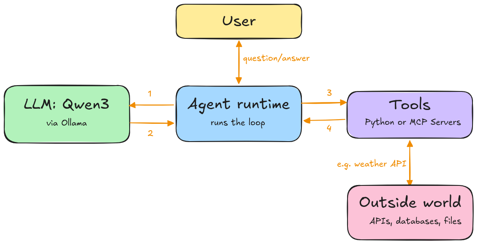

<h1> Welcome to the "AI App Builders" Program!</h1>
	


<!--  -->

</div>

## About This Course

November/December 2026 Holiday Program for [Strathmore School](https://www.strathmore.ac.ke/) students. A course on building **self-hosted** and **edge** AI apps for typical AI paradigms (e.g. Multimodal, RAG, AI agents) using opensource AI components and stacks.

**This program subscribes to:**

- **Complete setups**
  
  Students get both the finished apps and the full Python code behind it. All the AI models/apps can be run inside a Google Colab session in the cloud.
  
- **Modern AI Paradigms**
  
  Our case studies are guided by practical AI paradigms such as _Retrieval Augmented-Generation (RAG)_, Multimodality, Tool use, Function calling, AI agents, _Model Context Protocol (MCP)_, and Text-to-SQL
  
- **Open-Source, Open-Weights, and DIY Setups**
  
  We emphasize AI components and stacks that are publicly available for download and self-hosting:
  
  - Data Privacy first
  - No API billing
  - No Credit cards
  - No Rate limits  

## Slides

1. [Applied LLMs: The Big Picture](https://drive.google.com/file/d/1ofoLVHo2In_F0rd8rsIum7kWF5YRhUO7/view?usp=drive_link)
2. [Inside the Models: Tokens, Embeddings, Vector Databases](https://drive.google.com/file/d/1gGDWHjJdi05USaYA6P6KNdW3BqE08ihs/view?usp=drive_link)
3. [Inside an Agent: Messages, Tools and the Loop](https://drive.google.com/file/d/1UyhkVT-4wWjUUDmFcOC-sZGm_LimQDza/view?usp=drive_link)
4. [AI Data Analyst: Text2SQL, Databases and Charts](https://drive.google.com/file/d/1Bib4G1eQoYJ5gTsBvG95hbfBmZB-Tu5S/view?usp=drive_link)
5. [An Agent that checks its own Work](https://drive.google.com/file/d/1eXwkh_GsNKnodwZZg_IBg9wjGTo-5HLQ/view?usp=drive_link)

## Vibe Coding Prompts

### Colab Notebook Template

[](https://colab.research.google.com/drive/1yWHpLd-OdR-gcJPHwcz8YrL0lsqJ-nOO)

### Procedure

- Paste `ai_app_builder_template.ipynb` to a new chat along with the prompt "We are going to develop an app based on the notebook template attached."

- Use the following prompts

# 1\. Car dealership (rules about money and mileage)

## Prompt

I'm building "Car Deals Finder", an app where car dealerships in Nairobi list used cars for sale.

Cell 1 holds only my design, in five variables:

- APP\_TITLE: name of the app  
- TABLE: name of the table  
- DATA: one table as CSV text, with these columns: dealer, area, make, model, year, body\_type, mileage\_km, fuel, price\_ksh, discount\_percent, offer\_until. Make up about 12 realistic rows. Dates as YYYY-MM-DD.  
- RULES: one plain sentence per line explaining what the columns mean: "Prices are in KSh. 1.5M means 1500000." "The discount only counts if offer\_until is today or later." "body\_type is one of saloon, SUV, pickup or van." "Low mileage means under 80000 km."  
- EXAMPLE\_QUESTION: "cheapest SUV under 2M with low mileage"

## Response

```py
APP_TITLE = "Car Deals Finder"
TABLE_NAME = "cars"

DATA = """
dealer, area, make, model, year, body_type, mileage_km, fuel, price_ksh, discount_percent, offer_until
Oriel Limited, Mombasa Road, Subaru, Forester, 2017, SUV, 68000, petrol, 1980000, 5, 2026-12-15
Oriel Limited, Mombasa Road, Toyota, Hilux Double Cab, 2016, pickup, 92000, diesel, 2450000, 0, 2026-10-15
Al Siddique Motors, Ngong Road, Mazda, CX-5, 2018, SUV, 57000, petrol, 2350000, 6, 2026-12-20
Al Siddique Motors, Ngong Road, Honda, Fit, 2019, saloon, 46000, petrol, 1180000, 0, 2026-09-25
CarMax East Africa, Ngong Road, Nissan, Juke, 2018, SUV, 64000, petrol, 1890000, 5, 2026-12-10
CarMax East Africa, Ngong Road, Toyota, Vitz, 2018, saloon, 52000, petrol, 1120000, 8, 2026-11-30
Automark Kenya, Westlands, Toyota, Harrier, 2018, SUV, 61000, petrol, 2780000, 4, 2026-12-31
Automark Kenya, Westlands, Volkswagen, Golf, 2017, saloon, 73000, petrol, 1540000, 0, 2026-10-01
Magari Deals, Kilimani, Honda, Vezel, 2018, SUV, 55000, hybrid, 1960000, 6, 2026-12-18
Magari Deals, Kilimani, Toyota, HiAce, 2015, van, 115000, diesel, 2050000, 0, 2026-11-05
SokoMotor Yard, Industrial Area, Isuzu, D-Max, 2019, pickup, 62000, diesel, 2690000, 5, 2026-12-28
SokoMotor Yard, Industrial Area, Nissan, Note, 2019, saloon, 48000, petrol, 1150000, 10, 2026-12-05
"""

RULES = """
Prices are in KSh. 1.5M means 1500000.
The discount only counts if offer_until is today or later.
body_type is one of saloon, SUV, pickup or van.
Low mileage means under 80000 km.
"""

EXAMPLE_QUESTION = "cheapest SUV under 2M with low mileage"
```

# 2\. Matatu and bus fares (rules about time)

## Prompt

I'm building "Fare Finder", an app where matatu and bus saccos in Nairobi list their routes and fares.

Cell 1 holds only my design, in five variables:

- APP\_TITLE: name of the app  
- TABLE: name of the table  
- DATA: one table as CSV text, with these columns: sacco, route\_number, from\_stage, to\_stage, offpeak\_fare\_ksh, peak\_fare\_ksh, first\_trip, last\_trip. Make up about 12 realistic rows. Times as HH:MM in 24-hour format.  
- RULES: one plain sentence per line explaining what the columns mean: "Fares are in KSh." "Peak hours are 06:30 to 09:00 and 17:00 to 19:30; use peak\_fare\_ksh then, otherwise offpeak\_fare\_ksh." "A route is still running if the time asked about is between first\_trip and last\_trip." "Town means CBD."  
- EXAMPLE\_QUESTION: "cheapest way from Rongai to town at 8am"

## Response

```py
APP_TITLE = "Fare Finder"
TABLE_NAME = "fares"

DATA = """
sacco, route_number, from_stage, to_stage, offpeak_fare_ksh, peak_fare_ksh, first_trip, last_trip
Ongata Line, 125, Ongata Rongai, CBD, 80, 130, 05:00, 22:30
Nangkis Sacco, 125, Ongata Rongai, CBD, 80, 120, 05:15, 22:00
Super Metro, 11, Kikuyu, CBD, 90, 150, 05:00, 23:00
Citi Hoppa, 34, Pipeline, CBD, 50, 90, 05:00, 22:30
Forward Travellers, 46, Kawangware, CBD, 50, 80, 05:15, 22:00
KBS, 23, Kibera, CBD, 50, 80, 05:30, 21:30
Mwiki Travellers, 45, Mwiki, CBD, 60, 100, 05:00, 22:00
Rembo Shuttle, 102, Ruiru, CBD, 100, 160, 05:00, 21:30
Double M, 106, Ngong, CBD, 90, 140, 05:15, 22:00
Kileleshwa Shuttle, 12, Kileleshwa, CBD, 40, 70, 05:45, 21:30
Metro Shuttle, 2, Karen, CBD, 80, 130, 05:30, 21:00
Eastleigh Express, 6, Eastleigh, CBD, 40, 70, 05:00, 22:00
"""

RULES = """
Fares are in KSh.
Peak hours are 06:30 to 09:00 and 17:00 to 19:30; use peak_fare_ksh then, otherwise offpeak_fare_ksh.
A route is still running if the time asked about is between first_trip and last_trip.
Town means CBD.
"""

EXAMPLE_QUESTION = "cheapest way from Rongai to town at 8am"
```

# 3\. Five-a-side football turfs (rules about availability)

## Prompt

I'm building "Turf Finder", an app where five-a-side football turfs in Nairobi list their booking slots.

Cell 1 holds only my design, in five variables:

- APP\_TITLE: name of the app  
- TABLE: name of the table  
- DATA: one table as CSV text, with these columns: turf, area, surface, floodlights, day, start\_time, price\_per\_hour\_ksh, booked. Make up about 12 realistic rows. Times as HH:MM in 24-hour format.  
- RULES: one plain sentence per line explaining what the columns mean: "Prices are per hour, in KSh." "A slot can only be offered if booked is no." "floodlights is yes or no; any slot starting at 18:30 or later needs floodlights yes." "Split the price by the number of players if the customer says how many are coming."  
- EXAMPLE\_QUESTION: "free turf in Kilimani on Saturday evening, there are 10 of us"

## Response

```py
APP_TITLE = "Turf Finder"
TABLE_NAME = "turfs"

DATA = """
turf, area, surface, floodlights, day, start_time, price_per_hour_ksh, booked
Kilimani Pitches, Kilimani, artificial grass, yes, Saturday, 18:30, 4500, no
Kilimani Pitches, Kilimani, artificial grass, yes, Saturday, 19:30, 4500, yes
Kileleshwa 5s Arena, Kilimani, artificial grass, yes, Saturday, 17:00, 4000, no
Kileleshwa 5s Arena, Kilimani, artificial grass, yes, Saturday, 20:00, 4200, no
Westlands Cage, Westlands, artificial grass, yes, Saturday, 19:00, 5000, no
Westlands Cage, Westlands, artificial grass, no, Saturday, 16:00, 3200, no
Roysambu Kickabout, Roysambu, artificial grass, yes, Sunday, 18:30, 3500, no
Roysambu Kickabout, Roysambu, artificial grass, no, Sunday, 15:00, 2500, yes
Langata Astro Park, Langata, artificial grass, yes, Saturday, 19:00, 4200, no
Langata Astro Park, Langata, artificial grass, yes, Friday, 20:30, 4200, no
South B Goals, South B, artificial grass, yes, Saturday, 18:30, 3800, yes
South B Goals, South B, artificial grass, no, Sunday, 14:00, 2600, no
"""

RULES = """
Prices are per hour, in KSh.
A slot can only be offered if booked is no.
floodlights is yes or no; any slot starting at 18:30 or later needs floodlights yes.
Split the price by the number of players if the customer says how many are coming.
"""

EXAMPLE_QUESTION = "free turf in Kilimani on Saturday evening, there are 10 of us"
```

---


## Colab Notebooks

### **NEW!!!!**

[Food finder app](https://colab.research.google.com/drive/1mqAYr89-7BvHO6zIkNoFOnZMKPh60iAb)


A language model on its own can only predict the next word, so it guesses, sometimes confidently and wrongly. An agent wraps the model in a simple loop: it decides what to do, acts by calling a tool (running Python code, searching documents, querying a database), observes the result, and repeats until it can give an answer it has checked. 


 
Each app below is that same loop with a different tool: Code fixes date and letter-counting mistakes, document search grounds answers in a handbook, and SQL turns 92 years of World Cup data into charts. 

Students get both the working app and its full code: beginners start by experimenting with the app, while experienced coders extend it. The apps run on small, open models (Qwen3) inside Google Colab, with no paid AI service. That makes their mistakes easier to see, so students learn not just to build AI apps, but when to trust them and how to check their work.

---

### Python for AI Agents

[](https://colab.research.google.com/drive/1bYlqNORWIoQS1qKtk5szgVMczQE5Krn9)

### Working around LLM Limitations with agentic AI

[](https://colab.research.google.com/drive/1RMxUH2_omLJ2H1y4f-79f1NkB8lkdmEI)

- Large language models (LLMs) sometimes give confident but wrong answers a.k.a **hallucinations**, especially when they answer straight from the prompt, i.e. **zero-shot** mode.
- Other issues arise from internal mechanisms e.g. tokenization (i.e. handling text as tokens (words or pieces of words) rather than individual characters).
- These limitations are more pronounced with the smaller, self-hosted models that we'll be using e.g. Qwen.
- This video shows an AI agent checking its answer by running code instead of guessing, reducing hallucination [](https://youtu.be/XmSW0WxyhFw) 
- This video shows an agent using a tool to allow an LLM to count individual letters of words, circumventing limitations due to tokenization [](https://youtu.be/XNNcMLpdb3g)

---

### Answering questions from your own documents (RAG)

[](https://colab.research.google.com/drive/1NUTMP2q99FXAalZuNzQ3fv8wf-xk0hPO)

- An LLM only knows what it learned in training. RAG lets it search documents it has never seen, such as a school handbook, before answering.
- This video shows the agent finding the answer in a handbook and quoting its source [](https://youtu.be/sGuqe05esxo)

---

### Text-to-SQL: an AI data analyst

[](https://colab.research.google.com/drive/1zuLeuSNHVh2jZ00e0FKUSF33TpnA5lQ6)

- An LLM can turn a plain-English question into a database query (SQL). An AI agent goes further: it reads the database's error messages, fixes its own queries, and the app turns the results into charts.
- It still makes mistakes, so the SQL is always shown. Students learn to check the AI's work, not just trust it.

- This video shows the agent analysing 92 years of men's World Cup data [](https://youtu.be/_kUbgBJPulk)

---

### Multimodality: Helping a vision model with image tools

[](https://colab.research.google.com/drive/1NzGY2ni-TJNzCYGPvjtmogZRRgCig2Gz)

- A small vision language model (VLM) can make mistakes about what's in an image. External tools, such as an object detector (e.g. YOLO!) and cropping, help it check its own work.
- [](https://youtu.be/-8sPzFp-DHI)

---

### Capstone Projects

<!--
### A) School Sports Activity Planner

- Given a list of sports activities (by a student), the AI agent should be able to recommend a schedule for the week/month based on time of day, weather forecast, facility maintanance schedules, School calender, National calender, etc
    
### B) Fully-Edge Photo Album Assistant

- A **privacy first** and **offline** AI assistant capable of indexing a user's private collection of photos and retrieving them according to cross-modal queries (i.e. text prompts or image semantic searches)


-->


<!--
### AI Application Foundations

- We setup and explore the following basic AI Application Workflow

  
  
- Activities

  * Chat
  * _Visual Question Answering (VQA)_
  * Model switching for performance comparison and multimodality
-->
<!--
### C) Classroom / Lab 

- [](https://colab.research.google.com/drive/112DSm11HmI3j-Ousy5XHJ-vXQUvWiOah)
  
### D) Outcome

- _"I understand the essential components and structure of a DIY AI application."_
-->
<!--
## Building Custom AI App (Connecting AI to Software)

- We explore a few common use cases e.g.
	
  

- Activities
	
	* Text-to-SQL
	* Data analysis and Visualization of SQL query results (Charts, Graphs)
-->
<!--
### C) Classroom / Lab

- [](https://colab.research.google.com/drive/1282oV3I0y7MJoC5g0uhpVZuHcbFNeIbV)

### D) Outcome

- _"I can build a custom frontend to extend AI app usability"_
-->
<!--
## RAG Pipelines (Connecting AI to Knowledge)

- We explore and construct RAG pipelines for documents and images
	
	

- Activities
	- Summarize documents (PDFs, Markdown, etc) with an offline engine
	- Offline cross-modal semantic search on a private collection of images
-->  
<!--
### C) Classroom / Lab

- [](https://colab.research.google.com/drive/1lovtOi-YHYqpTAolaFedJIygIGlErUfa)
  
### D) Outcome
- _"I can build AI apps that can retrieve and analyze **privately** stored information."_
-->
<!--
## AI Agents (Connecting AI to Systems)

- We employ [Qwen-Agent](https://github.com/QwenLM/Qwen-Agent) for a fully edge AI solution capable of tool use, function calling, and MCP
  
  

- Activities
	- Connect/Implement tools e.g. Calculator tool, Weather tool, Web search tool, Home automation tool
<!--
### C) Classroom / Lab

- [](https://colab.research.google.com/drive/112DSm11HmI3j-Ousy5XHJ-vXQUvWiOah)
  
  
### D) Outcome
- _"I can automate how AI takes actions and interacts with external systems."_
-->
<!--
Notice this is not yet CrewAI territory.

No need for:

```text
Planner Agent
Research Agent
Writer Agent
Critic Agent
```
-->
<!--
## Capstone Projects
-->
